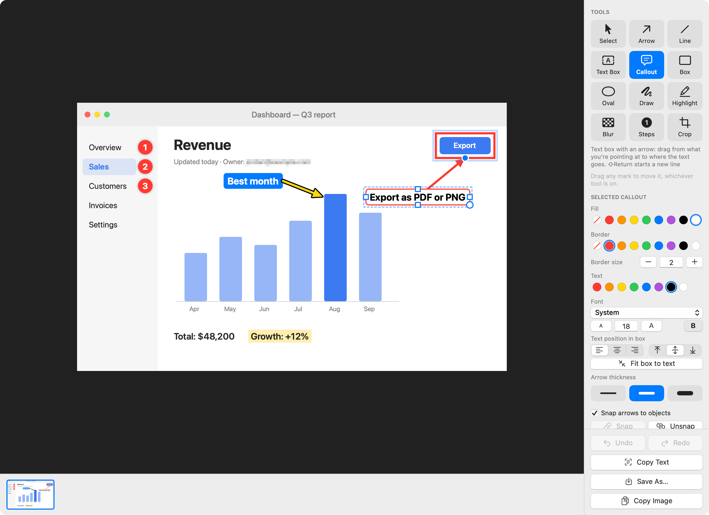

<p align="center">
  
</p>

<h1 align="center">Snag</h1>

<p align="center">
  A fast screenshot and annotation app for macOS.<br>
  Press a shortcut, pick what to capture, mark it up, paste it anywhere.
</p>

<p align="center">
  
</p>

Snag lives in the menu bar. A capture is copied to the clipboard the moment you take it and opens in an editor where every mark stays editable, even after you quit and come back.

## Contents

- [What it does](#what-it-does)
- [Install](#install)
- [First launch](#first-launch)
- [Capturing](#capturing)
- [Annotating](#annotating)
- [Snapping marks together](#snapping-marks-together)
- [Copy, paste and empty sessions](#copy-paste-and-empty-sessions)
- [Saving and where files live](#saving-and-where-files-live)
- [Shortcut reference](#shortcut-reference)
- [Troubleshooting](#troubleshooting)
- [Development](#development)

## What it does

- **One shortcut, three kinds of capture.** Drag for a region, click a window, or click the desktop for the whole screen.
- **Text grab.** Select an area and the text in it is recognised and copied.
- **Twelve tools.** Arrows, lines, text boxes, callouts, boxes, ovals, freehand, highlight, blur, numbered steps, crop and select.
- **Fill and border on everything.** Each mark has its own fill colour, border colour and border size, and either colour can be switched off.
- **Marks stay editable.** Move, resize, restyle or delete any mark later. Edits are saved automatically and reopen with the capture.
- **Snapping.** Drop an arrow on a box and the two move as one.
- **Room to spill over.** Marks dragged past the edge of the capture get extra space in the finished picture.

## Install

Snag is built from source. You need:

- macOS 14 (Sonoma) or later
- Xcode Command Line Tools. If you don't have them, run:

```bash
xcode-select --install
```

Then clone and build:

```bash
git clone https://github.com/Borzborz/Snag.git
```

```bash
cd Snag && ./build.sh --run
```

`build.sh` compiles a release build, wraps it into `Snag.app`, installs it at `~/Applications/Snag.app` and, with `--run`, launches it. Run the same command again to update after pulling new changes.

## First launch

1. A viewfinder icon appears in the menu bar. Snag has no Dock icon until the editor is open.
2. macOS asks for **Screen Recording** permission the first time you capture. Turn Snag on under **System Settings → Privacy & Security → Screen & System Audio Recording**, then quit and reopen Snag.
3. Optional: choose **Launch at Login** from the menu-bar menu.

## Capturing

| Shortcut | What it does |
| --- | --- |
| <kbd>⌃</kbd><kbd>⇧</kbd><kbd>C</kbd> | Capture a region, a window or the full screen |
| <kbd>⌃</kbd><kbd>⇧</kbd><kbd>F</kbd> | Capture the full screen straight away |
| <kbd>⌃</kbd><kbd>⇧</kbd><kbd>T</kbd> | Grab text: select an area, the text in it is copied |

After <kbd>⌃</kbd><kbd>⇧</kbd><kbd>C</kbd> the screen freezes and you choose what to keep:

- **Drag** to capture a region. A loupe shows the exact pixel under the cursor and the selection shows its size.
- **Click a window** to capture just that window. The window under the cursor is outlined in orange. Floating windows such as plug-in windows, inspectors and open menus count too.
- **Click the desktop, the menu bar or a screen edge** to capture the whole screen. <kbd>F</kbd>, <kbd>Return</kbd> or <kbd>Space</kbd> does the same.
- <kbd>Esc</kbd> or a right-click cancels.

The menu-bar menu also has **Capture Region in 5 Seconds**, for menus and hover states that vanish when you press a shortcut.

Every capture is copied to the clipboard, saved to `~/Pictures/Snag` and opened in the editor.

## Annotating

Pick a tool from the panel on the right or press its key.

| Tool | Key | How to use it |
| --- | --- | --- |
| Select | <kbd>V</kbd> | Click a mark to move, resize or delete it |
| Arrow | <kbd>A</kbd> | Drag to draw an arrow |
| Line | <kbd>L</kbd> | Drag to draw a straight line |
| Text Box | <kbd>T</kbd> | Click and type |
| Callout | <kbd>K</kbd> | Drag from what you're pointing at to where the text goes, then type |
| Box | <kbd>R</kbd> | Drag to draw a box |
| Oval | <kbd>O</kbd> | Drag to draw an oval |
| Draw | <kbd>P</kbd> | Draw freehand |
| Highlight | <kbd>H</kbd> | Drag over an area to highlight it |
| Blur | <kbd>B</kbd> | Drag over an area to hide it |
| Steps | <kbd>N</kbd> | Click to drop numbered circles: 1, 2, 3… |
| Crop | <kbd>C</kbd> | Drag to crop the image |

### Moving and reshaping marks

- **Drag any mark to move it**, whichever tool is active. The mark under the cursor glows before you grab it.
- **A new mark stays selected**, so you can adjust it straight away. Drag its round grips to reshape it.
- **Arrow keys nudge** the selected mark. Hold <kbd>⇧</kbd> to move further.
- **Hold <kbd>⇧</kbd> while drawing** for squares, circles and lines at 45° steps.
- **Hold <kbd>⌘</kbd> and drag** to grab a mark by its empty inside.
- **Right-click a mark** for Copy, Cut, Duplicate, Snap Together, Unsnap, Bring to Front, Send to Back and Delete.
- <kbd>Delete</kbd> removes the selected mark. <kbd>⌘</kbd><kbd>Z</kbd> undoes, <kbd>⇧</kbd><kbd>⌘</kbd><kbd>Z</kbd> redoes.

### Colours and sizes

The style panel shows the selected mark's style, or the style the current tool will draw with.

- **Fill** and **Border** each have a colour row. The first swatch, with a red slash, means no colour.
- **Border size** sets the thickness of whatever is drawn in the border colour.
- **Thickness** sets the body of arrows, lines and freehand strokes, and the size of step circles.
- Each tool remembers the style you last used with it.

### Text boxes and callouts

- <kbd>Return</kbd> finishes typing. <kbd>⇧</kbd><kbd>Return</kbd> starts a new line.
- **Double-click** a text box or callout to edit its words.
- **Font, size and bold** are in the style panel. The round grip at the box's bottom-right corner scales the type by dragging.
- **Drag a square side grip** to set the box's width or height. Text wraps to a set width.
- **Text position in box** aligns the words left, centre or right, and top, middle or bottom.
- **Fit box to text** returns a resized box to hugging its words.
- An empty callout stays where you put it, ready to be typed in later.

### Marks past the edge

Drag a mark outside the capture and the finished picture grows to hold it. **Marks past the image edge** in the panel chooses how:

- **Add white space** (the default)
- **Add transparent space**
- **Cut off at the image edge**

## Snapping marks together

With **Snap arrows to objects** switched on, an arrow or line end dropped on another mark fastens to it. A blue ring shows where it will land, and a snapped end's grip is filled blue.

- **Snapped marks move as one.** Drag the box and the arrow comes with it; drag the arrow and the box comes with it.
- **The connection keeps its place.** Resize the box and the arrow end stays at the same spot on its outline.
- **A callout's pointer tip** snaps the same way.
- **To unsnap**, drag the end off the mark, or select the mark and press **Unsnap** (also in the right-click menu).
- **Snap** fastens the selected mark to whatever it is already touching.
- **Hold <kbd>⌥</kbd> while dragging** to move one snapped mark on its own. The arrow stretches to stay attached.
- **Hold <kbd>⌘</kbd> while dragging an end** to place it without snapping.

## Copy, paste and empty sessions

- <kbd>⌘</kbd><kbd>C</kbd> with a mark selected copies that mark and anything snapped to it. With nothing selected it copies the whole annotated image.
- <kbd>⌘</kbd><kbd>V</kbd> pastes copied marks, into the same capture or another one.
- **Right-click empty space** and choose **Paste Here** to drop them at that spot.
- **New Empty Session** (<kbd>⌘</kbd><kbd>N</kbd>) opens the editor with nothing loaded. Press <kbd>⌘</kbd><kbd>V</kbd> there to turn an image on the clipboard into a new capture. A copied image file from Finder works too.
- **New from Clipboard** in the menu-bar menu does both steps at once.

## Saving and where files live

There is no save step. Edits are written a moment after each change.

| What | Where |
| --- | --- |
| Finished pictures (PNG) | `~/Pictures/Snag` |
| Editable marks and the untouched original | `~/Library/Application Support/Snag/Edits` |

- **Copy Image** puts the annotated picture on the clipboard.
- **Save As…** (<kbd>⌘</kbd><kbd>S</kbd>) exports a PNG or JPEG anywhere.
- **Copy Text** recognises the text in the capture and copies it.
- The strip along the bottom lists recent captures. Click one to reopen it with its marks, drag it into another app, or right-click it to show it in Finder or move it to the Trash.

Renaming a capture's file in Finder separates it from its editable marks; the picture itself is unaffected.

## Shortcut reference

| Shortcut | Action |
| --- | --- |
| <kbd>⌃</kbd><kbd>⇧</kbd><kbd>C</kbd> | Capture region, window or full screen |
| <kbd>⌃</kbd><kbd>⇧</kbd><kbd>F</kbd> | Capture full screen |
| <kbd>⌃</kbd><kbd>⇧</kbd><kbd>T</kbd> | Grab text |
| <kbd>⌘</kbd><kbd>N</kbd> | New empty session |
| <kbd>⌘</kbd><kbd>C</kbd> / <kbd>⌘</kbd><kbd>X</kbd> / <kbd>⌘</kbd><kbd>V</kbd> | Copy, cut, paste |
| <kbd>⌘</kbd><kbd>Z</kbd> / <kbd>⇧</kbd><kbd>⌘</kbd><kbd>Z</kbd> | Undo, redo |
| <kbd>⌘</kbd><kbd>S</kbd> | Save As… |
| <kbd>⌃</kbd><kbd>⌘</kbd><kbd>F</kbd> | Editor full screen |
| <kbd>Delete</kbd> | Delete the selected mark |
| Arrow keys, <kbd>⇧</kbd> + arrow keys | Nudge the selected mark by 1 or 10 points |
| <kbd>Esc</kbd> | Deselect, or cancel a capture |

## Troubleshooting

**Captures show only the desktop wallpaper, or Snag keeps asking for permission.**
Screen Recording permission is missing or stale. Open System Settings → Privacy & Security → Screen & System Audio Recording, remove Snag from the list, add it back, then quit and reopen Snag.

**Permission is lost every time I rebuild.**
macOS ties the permission to the app's code signature. `build.sh` signs with an "Apple Development" certificate if your keychain has one, which keeps the permission across rebuilds. Without one it signs ad hoc, and each rebuild counts as a new app. To use a specific certificate:

```bash
SNAG_SIGN_ID="Apple Development: Your Name (TEAMID)" ./build.sh --run
```

**A shortcut does nothing.**
Another app has claimed it. Snag shows "Some Snag shortcuts are already used by another app" at launch when that happens. Free the shortcut in the other app, or use the menu-bar menu.

**A window isn't picked up by hover.**
Only separate windows can be clicked. A panel drawn inside another window is part of that window; drag a region for it.

## Development

The app is a Swift Package with no dependencies, written in AppKit and SwiftUI. It builds with the Command Line Tools alone; Xcode is not required.

```
Package.swift
build.sh                     Builds, signs and installs Snag.app
Scripts/make_icon.swift      Draws the app icon
Sources/App/
  AppDelegate.swift          Menu-bar item, menus, global shortcuts
  HotKey.swift               Global hotkey registration
  ScreenCapturer.swift       Screen capture and text recognition
  SelectionOverlay.swift     The region / window / full-screen picker
  EditorController.swift     Editor window, tool and style panel
  CanvasView.swift           Drawing surface: mouse, keyboard, snapping
  Annotation.swift           The marks: geometry, hit-testing, drawing
  CaptureDocument.swift      A capture, its marks, undo, rendering
  Library.swift              Capture files and the clipboard
  EditStore.swift            Saved, re-editable marks
  RenderTest.swift           Scripted checks (see below)
  DemoShot.swift             Generates the screenshot in this README
```

Three hidden command-line flags help when changing the editor. Each writes a PNG and exits:

```bash
swift build -c release && .build/release/Snag --ui-test /tmp/ui.png
```

| Flag | What it does |
| --- | --- |
| `--render-test out.png` | Renders one of every mark and checks marks survive a save and reload |
| `--ui-test out.png` | Drives the editor with simulated mouse events and prints a pass/fail line per behaviour |
| `--demo-shot out.png` | Regenerates `docs/editor.png` |

The capture picker needs a real screen and Screen Recording permission, so it is tested by hand.
